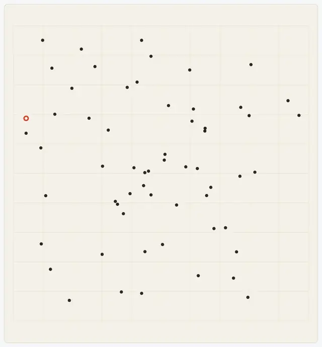

# mettle_tsp

This program solves the traveling salesman problem step by step and draws each step. It is written in [Mettle](https://github.com/The-Mettle-Project/Mettle) and draws its window with [MythicUI](https://github.com/Lex-Dellimere/MythicUI), and it uses no other libraries.



## Methods

- **Nearest neighbour, then 2-opt.** The first tour always goes to the nearest city it has not visited yet. 2-opt then tests every pair of edges and reverses the stretch between them when that makes the tour shorter. It stops when no reversal helps.
- **Simulated annealing.** The run starts from a random order and tries reversing random stretches. It always keeps a shorter tour. It keeps a longer one with probability exp(-increase / temperature), and the temperature falls on every step.
- **Exhaustive search.** The run tries every order that starts at city 0, so its answer is the shortest tour. It allows up to 10 cities, which have 362,880 orders.

Click the map to add a city and right-click a city to remove it.

## Build and run

You need the Mettle compiler and mbuild. mbuild fetches MythicUI from the registry.

```bash
mbuild run tsp
```

```bash
mbuild run check
```

`check` checks that every result is a tour, that 2-opt never lengthens the nearest-neighbour tour, and that exhaustive search matches a separate brute force on 30 maps of 4 to 9 cities.

## Files

- `src/tsp.mettle` holds the three solvers, which run one step per call.
- `src/app.mettle` draws the window.
- `src/main.mettle` opens the window.
- `tests/check.mettle` is the check above.
- `tools/snapshot.mettle` renders the app with no screen at points of a run and saves PNGs in `build/shots/`.
- `tools/compare.mettle` measures how far each method's tours are from the shortest tour.
- `tools/frames.mettle` saves one PNG per frame of a run, for animations.

## License

Apache-2.0
